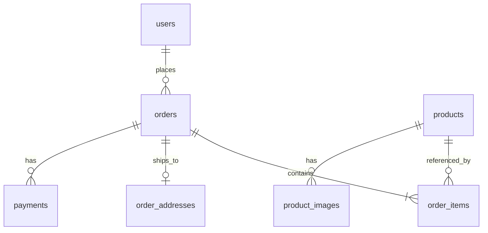

# E-commerce Database Schema

Digitized from the handwritten schema. Designed for a single-vendor storefront with customer and vendor roles.

## Conventions

- Every table has an `id` primary key (PK), which is indexed automatically.
- `FK` denotes a foreign key; `UNIQUE` denotes a uniqueness constraint.
- Suggested SQL types are included for implementation in PostgreSQL/Neon. They are recommendations rather than additional handwritten requirements.
- Store monetary amounts as `NUMERIC(12,2)`, not floating-point values.
- Use `TIMESTAMPTZ` for timestamps and `INTEGER` for quantities and image ordering.

## 1. `users`

| Column | Suggested type | Constraints / notes |
|---|---|---|
| `id` | UUID | PK |
| `name` | VARCHAR(255) | |
| `email` | VARCHAR(255) | |
| `role` | VARCHAR(20) | `vendor` or `customer` |
| `created_at` | TIMESTAMPTZ | Default current timestamp |
| `external_user_id` | VARCHAR(255) | UNIQUE; Clerk user ID |

> The handwritten design allows `id` to be the Clerk user ID instead. This version uses a separate internal UUID and a unique `external_user_id` for Clerk. Choose one approach consistently.

## 2. `products`

| Column | Suggested type | Constraints / notes |
|---|---|---|
| `id` | UUID | PK; internal product identifier |
| `sku` | VARCHAR(100) | UNIQUE; product code |
| `name` | VARCHAR(255) | |
| `description` | TEXT | |
| `price` | NUMERIC(12,2) | |
| `stock_quantity` | INTEGER | Nonnegative |

## 3. `product_images`

| Column | Suggested type | Constraints / notes |
|---|---|---|
| `id` | UUID | PK |
| `product_id` | UUID | FK → `products.id` |
| `alt_text` | TEXT | |
| `sort_order` | INTEGER | Display order |

**Constraint:** `UNIQUE (product_id, sort_order)` so that images of a given product have distinct display positions.

**Implementation note:** The handwritten design does not specify an image URL or storage key. Add an `image_url` or `storage_key` column before implementing image retrieval.

## 4. `orders`

| Column | Suggested type | Constraints / notes |
|---|---|---|
| `id` | UUID | PK |
| `user_id` | UUID | FK → `users.id` |
| `status` | VARCHAR(30) | `confirmed`, `shipped`, `delivered`, `pending_payment`, `cancelled` |
| `subtotal` | NUMERIC(12,2) | |
| `shipping_amount` | NUMERIC(12,2) | |
| `total_amount` | NUMERIC(12,2) | |
| `created_at` | TIMESTAMPTZ | Default current timestamp |

## 5. `order_items`

| Column | Suggested type | Constraints / notes |
|---|---|---|
| `id` | UUID | PK |
| `order_id` | UUID | FK → `orders.id` |
| `product_id` | UUID | FK → `products.id` |
| `product_name` | VARCHAR(255) | Snapshot at purchase |
| `sku` | VARCHAR(100) | Snapshot at purchase |
| `quantity` | INTEGER | Positive |
| `unit_price` | NUMERIC(12,2) | Price snapshot at purchase |

## 6. `order_addresses`

| Column | Suggested type | Constraints / notes |
|---|---|---|
| `id` | UUID | PK |
| `order_id` | UUID | FK → `orders.id`; UNIQUE (one address record per order) |
| `recipient_name` | VARCHAR(255) | |
| `phone` | VARCHAR(30) | |
| `address_line1` | TEXT | |
| `address_line2` | TEXT | Optional |
| `city` | VARCHAR(150) | |
| `pincode` | VARCHAR(20) | Store as text to preserve leading zeros |

## 7. `payments`

| Column | Suggested type | Constraints / notes |
|---|---|---|
| `id` | UUID | PK |
| `order_id` | UUID | FK → `orders.id` |
| `provider` | VARCHAR(100) | Payment gateway/provider |
| `provider_payment_id` | VARCHAR(255) | Provider's payment identifier |
| `amount` | NUMERIC(12,2) | |
| `status` | VARCHAR(20) | `failed` or `succeeded` in the handwritten design |
| `created_at` | TIMESTAMPTZ | Default current timestamp |

**Constraint:** `UNIQUE (provider, provider_payment_id)`.

> For a live gateway, you may also need a `pending` status (and potentially `refunded`) depending on its lifecycle. These are suggested extensions, not part of the original sketch.

## Relationships

## Indexes and constraints

All seven tables have a primary key on `id` (automatically indexed). The additional unique constraints explicitly noted in the sketch are:

| Table | Unique column(s) |
|---|---|
| `users` | `external_user_id` |
| `products` | `sku` |
| `order_addresses` | `order_id` |
| `payments` | (`provider`, `provider_payment_id`) |
| `product_images` | (`product_id`, `sort_order`) |

For efficient joins, consider ordinary indexes on foreign keys such as `orders.user_id`, `order_items.order_id`, `order_items.product_id`, `product_images.product_id`, and `payments.order_id`. PostgreSQL does not automatically create an index for every foreign key.

## Implementation notes

- Sync the Clerk user to `users` on signup, using the verified Clerk identity server-side; never trust a client-supplied role or external user ID.
- Create the order, its line items, and address together in a database transaction. Save product names, SKUs and unit prices as snapshots so historical orders do not change when product details change.
- Calculate totals on the server, not from client-supplied prices.
- Confirm successful payment from the provider's verified webhook/server-side verification before marking an order paid.
- The sketch does not include shipment tracking fields. If manual tracking is required, add `tracking_id` and optionally `courier_name` to `orders` or create a separate shipment table.
